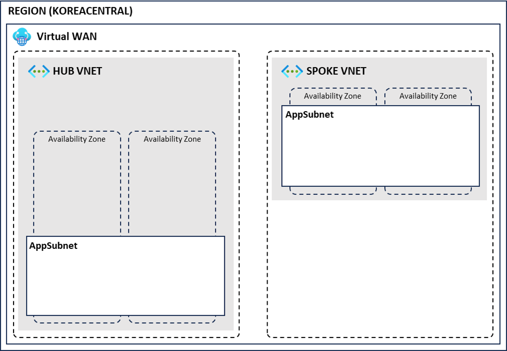

# 01. 네트워크 리소스 배포

## 개요와 학습 목표

리소스 그룹과 Azure Virtual WAN을 만들고, 가상 허브와 허브·스포크 가상 네트워크를 구성합니다.

## 사전 요구사항

<!-- TODO: 필요한 Azure 구독 권한과 사전 준비 사항을 저자가 확인해 작성 -->

## 소요 시간

<!-- TODO: 실제 실습 기준 소요 시간을 확인 -->

## 실습 단계

### 리소스 그룹 생성

1. 리소스 그룹 메뉴로 이동합니다.
2. 왼쪽 상단 만들기 버튼을 클릭합니다.
3. 리소스 그룹 이름에 `azure-intermediate-worshop-rg`를 입력하고 영역에 `(Asia Pacific) Korea Central`을 선택합니다.
4. 검토+만들기 버튼을 클릭한 후 만들기 버튼을 클릭합니다.

### 가상 WAN 생성

1. 가상 WAN 메뉴로 이동합니다.
2. 왼쪽 상단 만들기 버튼을 클릭합니다.
3. 다음과 같이 설정한 후 검토+만들기 버튼을 클릭하고 만들기 버튼을 클릭합니다.
   - 구독: 생성한 구독 선택
   - 리소스 그룹: `azure-intermediate-worshop-rg`
   - 지역: Korea Central
   - 이름: `korea-virtual-wan`
   - 유형: 표준

#### 허브 생성

1. 가상 WAN 화면에서 생성한 `korea-virtual-wan`을 선택합니다.
2. 왼쪽 메뉴에서 허브를 선택하고 상단의 새 허브 버튼을 클릭합니다.
3. 다음과 같이 설정한 후 검토 만들기 버튼을 클릭합니다.
   - 구독: 생성한 구독 선택
   - 지역: Korea Central
   - 이름: `vhub`
   - 허브 프라이빗 주소 공간: `10.0.0.0/16`
   - 가상 허브 용량: 2 라우팅 인프라 단위, 3 Gbps 라우터, 2000개 VM 지원
   - 허브 라우팅 기본 설정: ExpressRoute
4. 만들기 버튼을 클릭합니다.

> 리소스가 생성되는 동안 화면을 이동해도 배포는 계속됩니다.

### 가상 네트워크 생성

#### 허브 네트워크 생성

1. 가상 네트워크 메뉴로 이동합니다.
2. 왼쪽 상단 만들기 버튼을 클릭합니다.
3. 다음과 같이 설정한 후 다음 버튼을 두 번 클릭합니다.
   - 구독: 생성한 구독 선택
   - 리소스 그룹: `azure-intermediate-worshop-rg`
   - 가상 네트워크 이름: `hub-vnet`
   - 지역: `(Asia Pacific) Korea Central`
4. IP 주소 탭에서 CIDR 공간을 지정합니다.
   - 가상 네트워크 CIDR: `10.1.0.0/16`
   - default 서브넷의 연필 모양 아이콘을 클릭해 서브넷을 수정합니다.
     - 서브넷 이름: `app-subnet`
5. 검토+만들기 버튼을 클릭하고 만들기 버튼을 클릭합니다.

#### 스포크 네트워크 생성

1. 다음과 같이 설정합니다.
   - 가상 네트워크 이름: `spoke-vnet`
   - 가상 네트워크 CIDR: `10.2.0.0/16`
   - 서브넷 이름: `app-subnet`
2. 나머지는 위와 동일하게 가상 네트워크를 생성합니다.

## 검증

Azure Portal에서 `azure-intermediate-worshop-rg`, `korea-virtual-wan`, `vhub`, `hub-vnet`, `spoke-vnet`이 생성됐는지 확인합니다.

## 정리 (Clean-up)

<!-- TODO: 이 랩에서 생성한 리소스의 삭제 순서와 비용 중단 확인 방법을 저자가 작성 -->

## 트러블슈팅

<!-- TODO: E2E 검증에서 확인한 오류와 해결 방법을 저자가 작성 -->

## 이전·다음

[워크샵 홈](../README.md) | [다음: 보안 리소스 배포](../02-security-resource-deployment/README.md)
