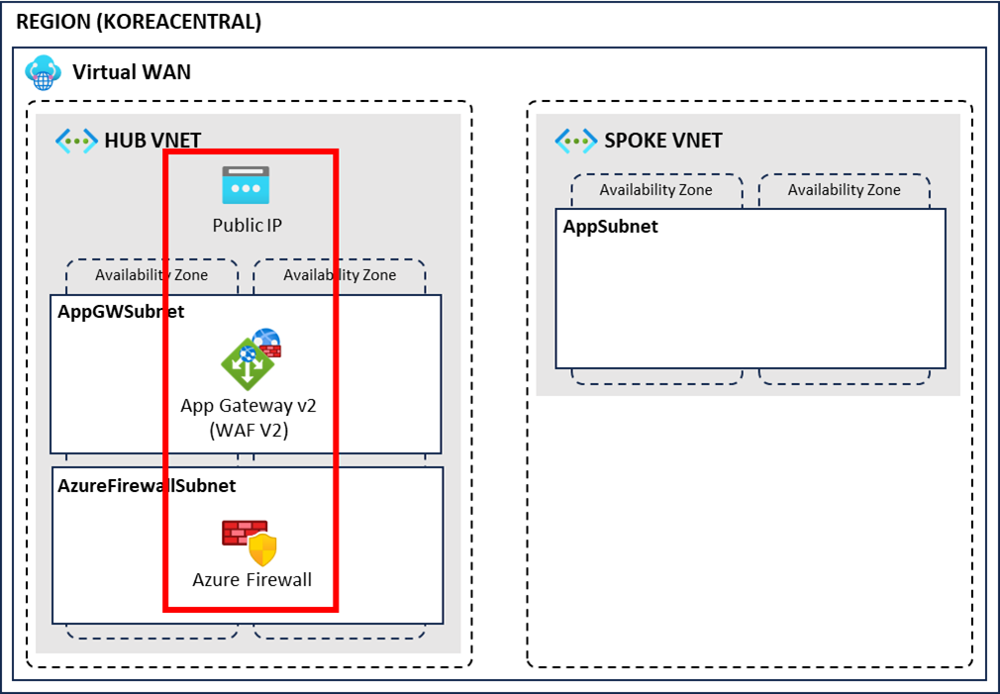
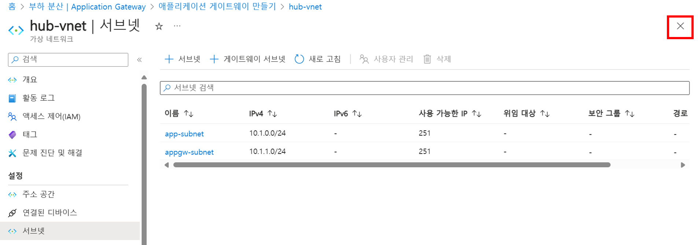
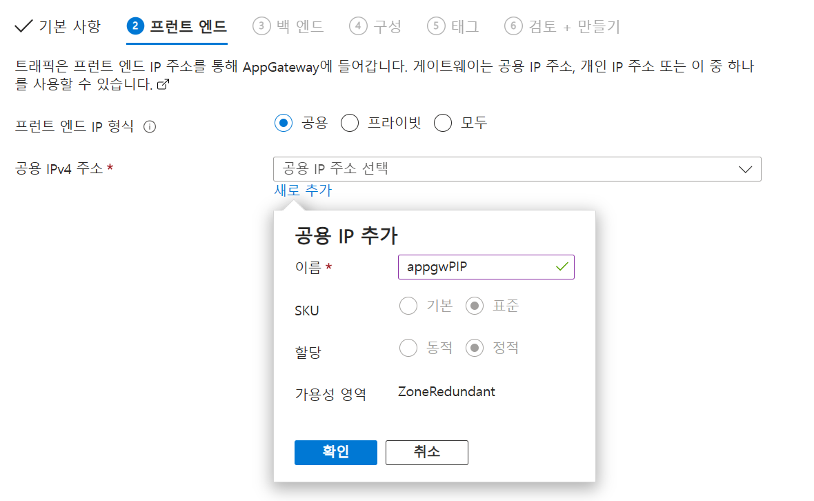

# 02. 보안 리소스 배포

## 개요와 학습 목표

Application Gateway WAF와 Azure Firewall을 배포하고 WAF 정책과 Firewall policy를 구성합니다.

## 사전 요구사항

[01. 네트워크 리소스 배포](../01-network-resource-deployment/README.md)를 완료해야 합니다.

[워크샵 권한과 예상 비용](../README.md#사전-요구사항)을 확인합니다. 동일한 실습 그룹의 Contributor 권한으로 진행하며, 이 랩의 Firewall Premium과 Application Gateway WAF v2는 트래픽이 없어도 기본 요금이 발생합니다.

## 소요 시간

예상 소요 시간은 약 55분입니다. Application Gateway와 Firewall 구성, 배포 대기, 정책 확인을 포함하며 배포 속도에 따라 늘어날 수 있습니다.

## 실습 단계

### Application Gateway 생성

1. 애플리케이션 게이트웨이 메뉴로 이동합니다.
2. 왼쪽 상단 만들기 버튼을 클릭합니다.
3. 다음과 같이 설정합니다.
   - 구독: 생성한 구독 선택
   - 리소스 그룹: `azure-intermediate-worshop-rg`
   - 게이트웨이 이름: `appGW`
   - 지역: Korea Central
   - 계층: WAF V2
   - 최소 인스턴스 수: 0
   - 가용성 영역: 영역 1, 2, 3
   - WAF 정책: 새로 만들기 클릭
     - 이름: `waf-default-policy`
   - 가상 네트워크: `hub-vnet`
   - 서브넷: 서브넷 구성 관리 클릭
     - 서브넷 버튼 클릭
     - 이름: `appgw-subnet`
     - 서브넷 주소 범위: `10.1.1.0/24`
     - 저장 버튼 클릭 후 오른쪽 상단 X 버튼 클릭

   

4. 다음: 프런트 엔드 > 버튼을 클릭합니다.
5. 프런트 엔드 IP 형식은 `공용`으로 설정하고 공용 IPv4 주소에서 새로 추가를 클릭합니다.
6. 이름에 `appgwPIP`를 입력하고 확인을 클릭합니다.

   

7. 다음: 백 엔드 > 버튼을 클릭합니다.
8. 백 엔드 풀 추가를 클릭합니다.
9. 이름에 `backend-pool`을 입력하고 추가를 클릭합니다.
10. 다음: 구성 > 버튼을 클릭합니다.
11. 회람 규칙 추가 버튼을 클릭합니다.
12. 다음과 같이 구성하고 추가 버튼을 클릭합니다.
    - 규칙 이름: `http-rule`
    - 우선 순위: 100
    - 수신기
      - 수신기 이름: `http-listener`
      - 프런트 엔드 IP: 공용 IPv4
      - 프로토콜: HTTP
      - 포트: 80
    - 백 엔드 대상
      - 백 엔드 대상: `backend-pool`
      - 백 엔드 설정: 새로 추가 클릭
        - 백 엔드 설정 이름: `backend-config`
        - 나머지 설정 그대로 두고 추가 버튼 클릭
13. 다음: 태그 >, 다음: 검토 + 만들기 > 버튼을 차례로 클릭한 후 구성을 확인하고 만들기 버튼을 클릭합니다.

#### WAF 정책 확인

1. WAF(Web Application Firewall) 정책 메뉴로 이동합니다.
2. 생성한 `waf-default-policy`를 클릭합니다.
3. 왼쪽 메뉴에서 관리형 규칙을 선택합니다.
4. 개요에서 `방지 모드로 전환`을 클릭합니다.
5. 할당 버튼을 클릭하고 봇 관리 규칙 집합에서 `Microsoft_BotManagerRuleSet_1.0`을 선택한 후 저장 버튼을 클릭합니다.

### 방화벽 배포

#### AzureFirewallSubnet 서브넷 추가

1. 가상 네트워크 메뉴로 이동합니다.
2. 생성한 `hub-vnet`을 선택합니다.
3. 왼쪽 메뉴에서 서브넷을 클릭합니다.
4. 다음과 같이 구성하고 저장 버튼을 클릭합니다.
   - 이름: `AzureFirewallSubnet`
   - 서브넷 주소 범위: `10.1.2.0/26`

> `AzureFirewallSubnet` 서브넷의 크기는 `/26`입니다.

#### 방화벽 배포

1. 방화벽 메뉴로 이동합니다.
2. 왼쪽 상단 만들기 버튼을 클릭합니다.
3. 다음과 같이 구성하고 다음: 태그 > 버튼을 클릭합니다.
   - 구독: 생성한 구독 선택
   - 리소스 그룹: `azure-intermediate-worshop-rg`
   - 이름: `default-firewall`
   - 지역: Korea Central
   - 방화벽 SKU: 프리미엄
   - Firewall policy: Add new 클릭
     - 정책 이름: `default-fw-policy`
   - 가상 네트워크 선택: 기존 항목 사용
   - 가상 네트워크: `hub-vnet`
   - 공용 IP 주소: 새로 추가
     - 이름: `FWPIP`
4. 다음: 검토 + 만들기 > 버튼을 클릭하고 만들기 버튼을 클릭합니다.

## 검증

Azure Portal에서 `appGW`, `waf-default-policy`, `default-firewall`, `default-fw-policy`가 생성됐는지 확인합니다.

## 정리 (Clean-up)

계속 진행한다면 보안 리소스를 유지합니다. 실습을 중단하거나 전체 실습을 완료하면 [워크샵 정리 절차](../README.md#정리-clean-up)를 수행합니다. 개별 삭제가 필요할 때는 `appGW`, `default-firewall`을 먼저 삭제하고, 다른 참조가 없는 `waf-default-policy`, `default-fw-policy`, `appgwPIP`, `FWPIP`를 뒤에 삭제합니다. Gateway의 최소 인스턴스 수를 0으로 바꾸는 것은 정리를 대신하지 않습니다.

## 트러블슈팅

[워크샵 배포 설정 점검](../README.md#배포-설정-점검)에서 Application Gateway, Firewall와 정책 설정을 확인합니다.

## 이전·다음

[이전: 네트워크 리소스 배포](../01-network-resource-deployment/README.md) | [워크샵 홈](../README.md) | [다음: 테스트 시스템 배포](../03-test-system-deployment/README.md)
