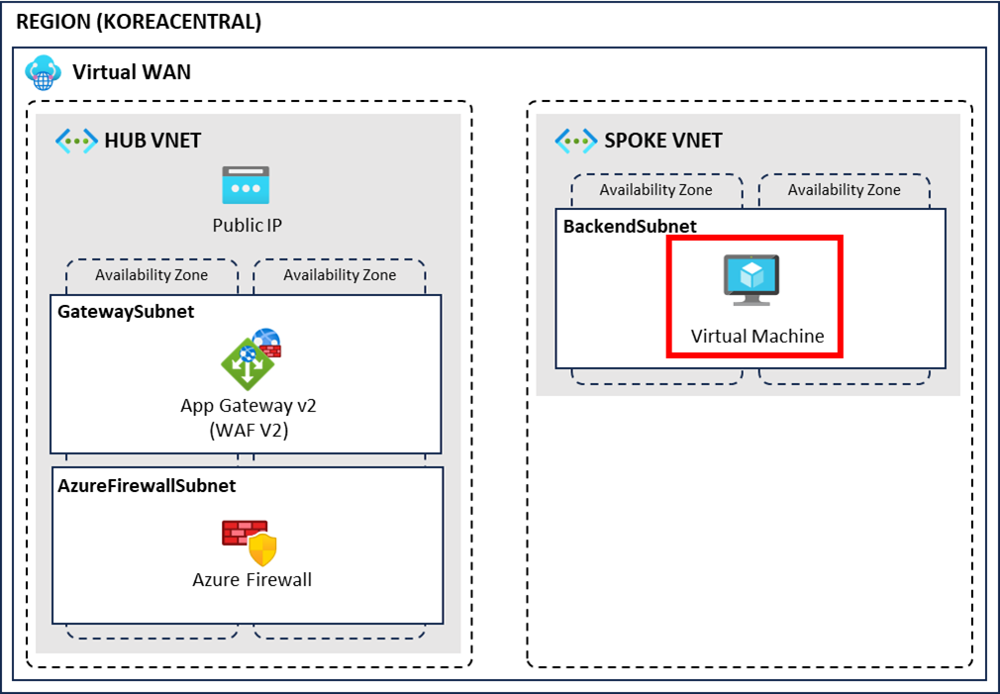

# 03. 테스트 시스템 배포



## 개요와 학습 목표

스포크 네트워크에 백엔드 가상 머신을 배포하고 Nginx를 설치합니다.

## 사전 요구사항

[02. 보안 리소스 배포](../02-security-resource-deployment/README.md)를 완료해야 합니다.

## 소요 시간

<!-- TODO: 실제 실습 기준 소요 시간을 확인 -->

## 실습 단계

### 가상 머신 생성

1. 가상 머신 메뉴로 이동합니다.
2. 왼쪽 상단 만들기 버튼을 클릭합니다.
3. 다음과 같이 설정합니다.
   - 구독: 생성한 구독 선택
   - 리소스 그룹: `azure-intermediate-worshop-rg`
   - 가상 머신 이름: `backend-vm`
   - 지역: `(Asia Pacific) Korea Central`
   - 가용성 영역: 영역 1
   - 이미지: Ubuntu Server 20.04 LTS - x64 Gen2
   - 크기: Standard_D2s_v3
   - 인증 형식: 암호
     - 사용자 이름: `azureuser`
     - 암호: 수강자가 직접 생성한 강력한 실습 전용 암호
   - 공용 인바운드 포트: 선택한 포트 허용
   - 인바운드 포트 선택: SSH (22)
4. 다음: 디스크 > 버튼을 클릭하고 다음: 네트워킹 > 버튼을 클릭합니다.
5. 네트워킹 탭에서 다음과 같이 설정합니다.
   - 가상 네트워크: `spoke-vnet`
   - 서브넷: `app-subnet`
   - 공용 IP: `(새로 만드는 중) backend-vm-ip`
6. 검토 + 만들기 버튼을 클릭하고 만들기 버튼을 클릭합니다.

> 다른 계정이나 워크샵에서 사용한 암호를 재사용하지 않습니다. 실습을 마치면 가상 머신과 관련 공용 IP를 삭제합니다.

### 가상 머신 구성

1. 가상 머신이 생성되면 해당 가상 머신 화면으로 이동합니다.
2. 왼쪽 메뉴에서 네트워크 설정을 선택합니다.
3. 네트워크 보안 그룹의 포트 규칙 만들기 버튼을 클릭하고 인바운드 포트 규칙을 선택합니다.
4. 다음과 같이 설정한 후 추가 버튼을 클릭합니다.
   - 소스: Any
   - 원본 포트 범위: `*`
   - 대상 주소: Any
   - 서비스: SSH
5. 왼쪽 메뉴에서 개요를 선택하고 공용 IP 주소를 확인합니다.
6. 로컬 컴퓨터에서 터미널 프로그램을 실행합니다.
7. 터미널에 아래 명령어를 입력해 가상 머신에 접속합니다.

   ```bash
   ssh azureuser@<공용 IP 주소>
   ```

8. 아래 명령어를 입력해 Nginx를 설치합니다.

   ```bash
   sudo apt update
   sudo apt install nginx
   ```

## 검증

가상 머신에 SSH로 접속되고 Nginx 설치 명령이 오류 없이 완료되는지 확인합니다.

## 정리 (Clean-up)

<!-- TODO: 최종 연결 테스트 후 가상 머신, 디스크, NIC, 공용 IP의 삭제 순서를 저자가 작성 -->

## 트러블슈팅

<!-- TODO: SSH 연결과 Nginx 설치 과정에서 확인한 오류와 해결 방법을 저자가 작성 -->

## 이전·다음

[이전: 보안 리소스 배포](../02-security-resource-deployment/README.md) | [워크샵 홈](../README.md) | [다음: 네트워크 연결 확인](../04-network-connectivity-check/README.md)
