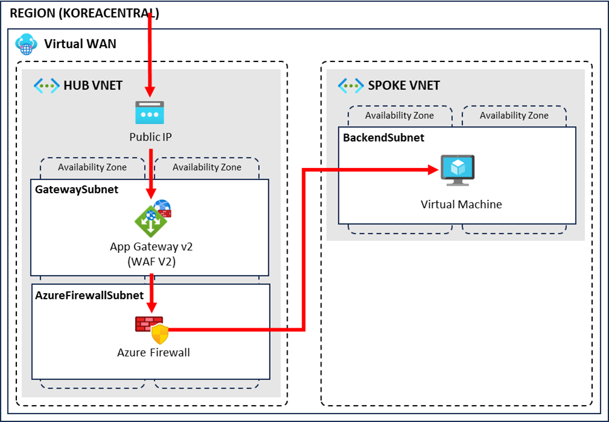
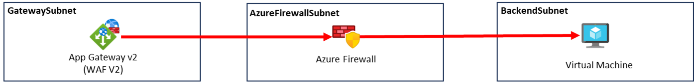
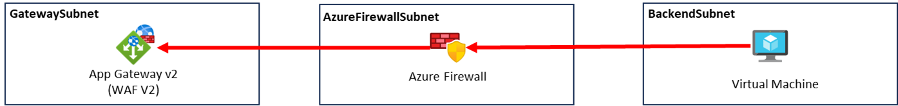
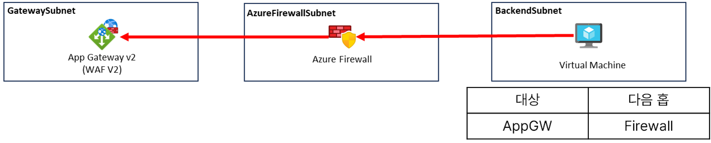
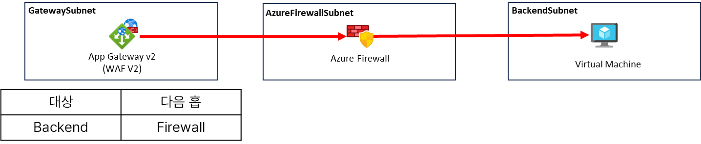
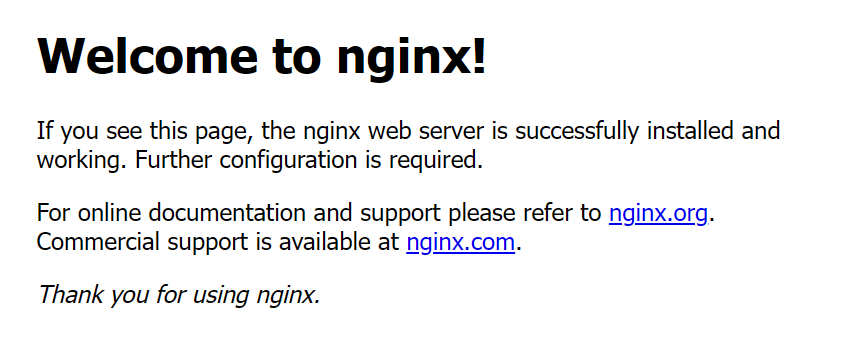

# 04. 네트워크 연결 확인

## 개요와 학습 목표

가상 WAN에 허브·스포크 네트워크를 연결하고 Application Gateway, Azure Firewall, 경로 테이블을 구성한 뒤 네트워크 연결을 확인합니다.

## 사전 요구사항

[03. 테스트 시스템 배포](../03-test-system-deployment/README.md)를 완료해야 합니다.

동일 실습 그룹의 Contributor 권한과 [워크샵 연결 조건](../README.md#사전-요구사항)을 확인합니다. Application Gateway 공용 IP의 HTTP 80번 포트로 접속할 브라우저가 필요합니다.

## 소요 시간

예상 소요 시간은 약 50분입니다. 가상 WAN 연결, 방화벽 규칙·경로 테이블 구성과 HTTP 테스트를 포함합니다. 전체 리소스 삭제는 워크샵의 별도 마무리 20분에서 시작합니다.

## 실습 단계

### 가상 WAN에 가상 네트워크 연결

#### 허브 네트워크 연결

1. 가상 WAN 메뉴로 이동해 `korea-virtual-wan`을 선택합니다.
2. 왼쪽 메뉴에서 가상 네트워크 연결을 클릭합니다.
3. 잠시 기다렸다가 연결 추가 버튼이 활성화되면 클릭합니다.
4. 다음과 같이 구성하고 만들기 버튼을 클릭합니다.
   - 연결 이름: `hub`
   - 허브: `vhub`
   - 리소스 그룹: `azure-intermediate-worshop-rg`
   - 가상 네트워크: `hub-vnet`
   - 전파 안함: 아니요
   - 경로 테이블 연결: Default
   - 경로 테이블로 전파: Default
   - 레이블로 전파: default
   - 나머지 기본 설정

#### 스포크 네트워크 연결

1. 다음과 같이 설정합니다.
   - 연결 이름: `spoke`
   - 허브: `vhub`
   - 리소스 그룹: `azure-intermediate-worshop-rg`
   - 가상 네트워크: `spoke-vnet`
2. 나머지는 위와 동일하게 가상 네트워크를 연결합니다.

### Application Gateway 백엔드 풀 설정

1. 애플리케이션 게이트웨이 메뉴로 이동합니다.
2. 생성한 `appGW`를 클릭합니다.
3. 왼쪽 메뉴에서 백 엔드 풀을 선택합니다.
4. `backend-pool`을 클릭합니다.
5. 대상 유형에서 가상 머신을 클릭하고 생성한 `backend-vm`의 프라이빗 IP를 입력합니다.
6. 저장 버튼을 클릭합니다.

### 방화벽 규칙 구성

다음 정보를 기록합니다.

- `hub-vnet/appgw-subnet`의 CIDR
- `spoke-vnet/app-subnet`의 CIDR
- 방화벽의 개인 IP

1. 방화벽 메뉴로 이동합니다.
2. 생성한 `default-firewall`을 클릭합니다.
3. 개요 하단 Firewall policy에서 생성한 `default-fw-policy`를 클릭합니다.
4. 왼쪽 메뉴에서 네트워크 규칙을 선택합니다.
5. 규칙 컬렉션 추가 버튼을 클릭하고 아래 두 개의 규칙을 구성합니다.

#### AppGW-to-Backend Rule

- 이름: `app-rules`
- 규칙 컬렉션 형식: 네트워크
- 우선 순위: 1000
- 규칙 컬렉션 작업: 허용
- 규칙 컬렉션 그룹: `DefaultNetworkRuleCollectionGroup`
- 규칙
  - 이름: `AppGW-to-Backend`
  - 원본: `<appgw-subnet의 CIDR>`
  - 프로토콜: 모두
  - 대상 포트: `*`
  - 대상 유형: IP 주소
  - 대상: `<app-subnet의 CIDR>`

> 규칙이 추가된 후 다음 작업을 진행합니다.

#### Backend-to-AppGW Rule

- 이름: `appgw-rules`
- 규칙 컬렉션 형식: 네트워크
- 우선 순위: 1001
- 규칙 컬렉션 작업: 허용
- 규칙 컬렉션 그룹: `DefaultNetworkRuleCollectionGroup`
- 규칙
  - 이름: `Backend-to-AppGW`
  - 원본: `<app-subnet의 CIDR>`
  - 프로토콜: 모두
  - 대상 포트: `*`
  - 대상 유형: IP 주소
  - 대상: `<appgw-subnet의 CIDR>`

### 경로 테이블 구성

아래 두 개의 경로 테이블을 구성합니다.

#### app-udr

1. 만들기 버튼을 클릭합니다.
2. 다음과 같이 구성한 후 검토 + 만들기, 만들기 버튼을 클릭합니다.
   - 구독: 생성한 구독
   - 리소스 그룹: `azure-intermediate-worshop-rg`
   - 지역: Korea Central
   - 이름: `app-udr`
   - 게이트웨이 경로 전파: Yes
3. 생성된 경로 테이블 화면으로 이동합니다.
4. 왼쪽 메뉴에서 경로를 선택합니다.
5. 추가 버튼을 클릭합니다.
6. 다음과 같이 구성한 후 추가 버튼을 클릭합니다.
   - 경로 이름: `firewall`
   - 대상 유형: IP 주소
   - 대상 IP주소/CIDR 범위: `<appgw-subnet의 CIDR>`
   - 다음 홉 형식: 가상 어플라이언스
   - 다음 홉 주소: `<방화벽의 개인 IP>`
7. 왼쪽 메뉴에서 서브넷을 선택합니다.
8. 연결 버튼을 클릭합니다.
9. 서브넷 연결에서 가상 네트워크를 `spoke-vnet`, 서브넷을 `app-subnet`으로 선택하고 확인 버튼을 클릭합니다.

#### appgw-udr

1. 만들기 버튼을 클릭합니다.
2. 다음과 같이 구성한 후 검토 + 만들기, 만들기 버튼을 클릭합니다.
   - 구독: 생성한 구독
   - 리소스 그룹: `azure-intermediate-worshop-rg`
   - 지역: Korea Central
   - 이름: `appgw-udr`
   - 게이트웨이 경로 전파: Yes
3. 생성된 경로 테이블 화면으로 이동합니다.
4. 왼쪽 메뉴에서 경로를 선택합니다.
5. 추가 버튼을 클릭합니다.
6. 다음과 같이 구성한 후 추가 버튼을 클릭합니다.
   - 경로 이름: `to-firewall`
   - 대상 유형: IP 주소
   - 대상 IP주소/CIDR 범위: `<app-subnet의 CIDR>`
   - 다음 홉 형식: 가상 어플라이언스
   - 다음 홉 주소: `<방화벽의 개인 IP>`
7. 왼쪽 메뉴에서 서브넷을 선택합니다.
8. 연결 버튼을 클릭합니다.
9. 서브넷 연결에서 가상 네트워크를 `hub-vnet`, 서브넷을 `appgw-subnet`으로 선택하고 확인 버튼을 클릭합니다.

### 보안 그룹 구성

1. 가상 머신 화면으로 이동합니다.
2. 생성한 `backend-vm`을 선택합니다.
3. 왼쪽 메뉴에서 네트워크 설정 메뉴를 선택합니다.
4. 네트워크 보안 그룹에서 포트 규칙 만들기 버튼을 클릭하고 인바운드 포트 규칙을 선택합니다.
5. 다음과 같이 구성하고 추가 버튼을 클릭합니다.
   - 원본 포트 범위: `*`
   - 대상 주소: Any
   - 서비스: HTTP

## 검증

1. `appGW`의 Public IP를 복사합니다.
2. 브라우저에서 새 탭을 열고 `http://<appGW의 Public IP>`를 입력합니다.
3. Nginx 기본 페이지가 표시되면 정상입니다.

## 정리 (Clean-up)

연결 결과를 확인한 뒤 [워크샵 정리 절차](../README.md#정리-clean-up)를 수행합니다. 먼저 실습용 `hub`, `spoke` 가상 WAN 연결을 삭제하고, 실습 전용 그룹 전체를 삭제하는 방식을 권고합니다. 그룹 전체 삭제가 불가능하면 중앙 절차의 개별 삭제 순서에 따라 `app-udr`, `appgw-udr` 연결 해제와 잔여 리소스 확인까지 완료합니다. 삭제 요청 후 실제 완료를 확인해야 하며 세션 종료 후에도 기다려야 할 수 있습니다.

## 트러블슈팅

Backend health가 Unhealthy이거나 HTTP 502가 발생하면 [워크샵 Backend health와 HTTP 502 점검](../README.md#backend-health와-http-502-점검)에 따라 Nginx, backend 설정, NSG와 UDR을 확인합니다.

## 이전·다음

[이전: 테스트 시스템 배포](../03-test-system-deployment/README.md) | [워크샵 홈](../README.md)
