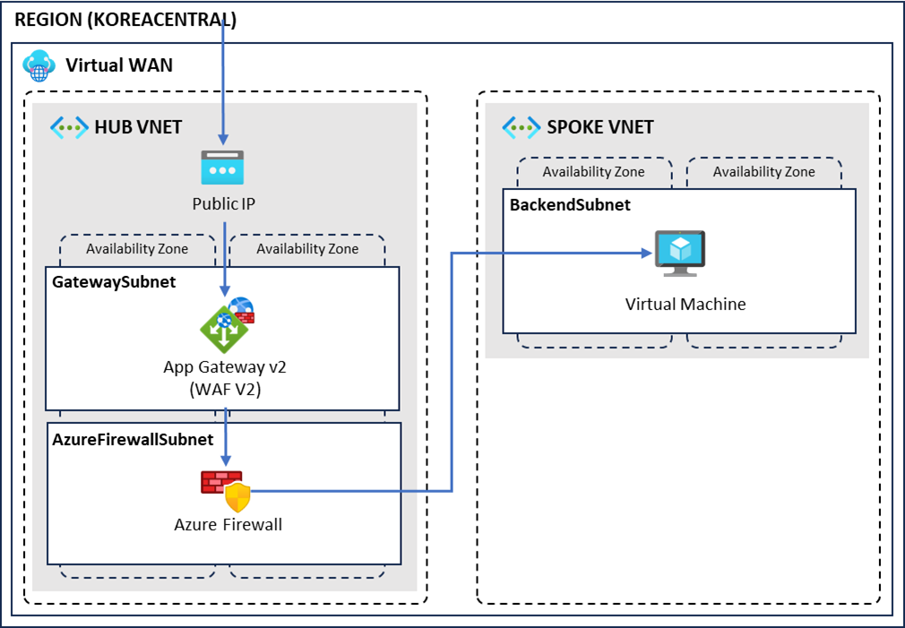

# Azure Landing Zone Workshop with Azure Virtual WAN

## 개요와 학습 목표

Azure Virtual WAN을 사용해 Azure Landing Zone의 기본 네트워크를 구성하는 워크샵입니다. Azure Virtual WAN, Application Gateway WAF, Azure Firewall을 배포한 뒤 허브와 스포크 네트워크의 연결을 확인합니다.

대상 수준은 **L200~300**이며, 이론과 실습을 포함해 **4시간**으로 구성합니다. 이론 세션에서는 Azure Landing Zone을 소개하고, 실습 세션에서는 Hub-Spoke 기반의 Application Gateway(WAF v2)–Firewall–VM 구성을 만듭니다. 현재 실습은 Azure Virtual WAN으로 두 가상 네트워크를 연결합니다. 관리 그룹, 구독 구성, 조직 전체 Azure Policy 등 전체 Landing Zone 배포는 실습 범위에 포함하지 않습니다.

이 워크샵을 마치면 다음 작업을 수행할 수 있습니다.

- Azure Virtual WAN과 가상 허브 구성
- 허브·스포크 가상 네트워크와 보안 리소스 배포
- Application Gateway와 Azure Firewall 규칙 구성
- 테스트 시스템을 사용한 네트워크 연결 확인

## 사전 요구사항

### 계정과 구독 권한

- 활성 Azure 구독과 [Azure Portal](https://portal.azure.com/)에 로그인할 계정이 필요합니다.
- 문서대로 리소스 그룹 생성부터 진행하려면 해당 구독의 **Contributor** 역할을 권고합니다. 역할 부여는 구독 관리자가 사전에 수행하며, 수강자에게 Owner 역할을 부여할 필요는 없습니다.
- 권한 범위를 줄이려면 관리자가 실습 전용 리소스 그룹을 먼저 만들고 수강자에게 그 그룹의 Contributor 역할만 부여합니다. 이때 첫 랩의 그룹 생성은 건너뜁니다. 그룹은 수강자별로 분리하고, 다른 업무 리소스가 있는 그룹은 사용하지 않습니다.
- 그룹 범위 권한만 부여할 때는 관리자가 구독의 `Microsoft.Network`, `Microsoft.Compute`, `Microsoft.Storage` 등록 상태를 사전에 확인합니다. 리소스 공급자 등록은 구독 범위 작업입니다.
- Korea Central에서 VM `Standard_D2s_v3` 1대에 필요한 DSv3 계열 및 전체 리전 vCPU 할당량(2 vCPU 이상)을 확인합니다. 이미지·SKU·가용 영역의 실제 사용 가능 여부는 구독에 따라 달라집니다.
- Azure Policy로 공용 IP, 리소스 SKU 또는 리전을 차단하는 구독은 관리자와 실습 허용 범위를 먼저 협의합니다. 차단 정책이나 삭제 잠금을 임의로 해제하지 않습니다.

브라우저와 로컬 SSH 클라이언트도 준비합니다. 실습 네트워크에서 VM 공용 IP의 TCP 22번 포트와 Application Gateway 공용 IP의 TCP 80번 포트로 연결할 수 있어야 합니다.

권한 근거: [Contributor 역할](https://learn.microsoft.com/en-us/azure/role-based-access-control/built-in-roles/privileged#contributor), [리소스 공급자 등록](https://learn.microsoft.com/en-us/azure/azure-resource-manager/management/resource-providers-and-types).

### 예상 비용

아래는 **2026-10-11 조회한 Korea Central의 USD 공개 종량제 단가**를 사용한 계획용 추정입니다. 수강자 1명이 구성 1세트를 사용하고, 모든 리소스를 4시간 유지하며, 테스트 트래픽이 적다는 조건입니다. 실제로는 서비스별 생성·삭제 시각, 사용량과 계약 할인에 따라 달라집니다. 세금과 환율은 포함하지 않습니다.

| 리소스 | 계산 조건 | 4시간 기본 요금 |
|---|---|---|
| Azure Firewall Premium | 1개, 배포 기본 요금 1.75 USD/시간 | 7.00 USD |
| Application Gateway WAF v2 | 1개, 고정 요금 0.486 USD/시간 | 약 1.94 USD |
| Virtual WAN Standard hub | 허브 1개 0.25 USD/시간 + routing infrastructure unit 2개 × 0.10 USD/시간 | 1.80 USD |
| Linux VM | `Standard_D2s_v3` 1대, 0.123 USD/시간 | 약 0.49 USD |
| Standard IPv4 공용 IP | 3개 × 0.005 USD/시간 | 0.06 USD |
| OS 디스크 | 예: 64 GiB Premium SSD P6 LRS, 10.207 USD/월을 730시간으로 환산 | 약 0.06 USD |
| 합계 | 용량·트래픽 요금 제외 | **약 11.4 USD** |

Application Gateway capacity unit(0.0144 USD/CU·시간), 적용되는 Firewall capacity unit 요금, Firewall 데이터 처리(0.016 USD/GB), 허브 데이터 처리(0.02 USD/GB), 인터넷 송신 등은 별도입니다. 디스크 크기와 SKU도 실제 생성 화면에서 확인합니다. VPN·ExpressRoute gateway, Bastion, 추가 진단 저장소는 이 계산에 포함하지 않습니다.

운영 준비용 예산은 **4시간에 15~20 USD/인**을 권고합니다. 생성·삭제 대기로 6시간 유지할 수 있다면 25~30 USD/인을 준비합니다. 이는 상한을 보장하는 견적이 아니며, 행사 전에 [Azure Pricing Calculator](https://azure.microsoft.com/en-us/pricing/calculator/)에서 같은 리전·SKU·사용시간으로 다시 확인해야 합니다.

> Application Gateway의 최소 인스턴스 수가 0이어도 고정 요금은 발생합니다. VM만 중지하거나 할당 해제해도 Firewall, 허브, Application Gateway, 디스크와 공용 IP 요금은 남을 수 있습니다. Budget 알림은 비용 통지이지 자동 과금 중단 장치가 아닙니다.

가격 근거: [Azure Retail Prices API](https://learn.microsoft.com/en-us/rest/api/cost-management/retail-prices/azure-retail-prices), [Application Gateway 과금 구조](https://learn.microsoft.com/en-us/azure/application-gateway/understanding-pricing), [Cost Management 알림](https://learn.microsoft.com/en-us/azure/cost-management-billing/costs/cost-mgt-alerts-monitor-usage-spending).

## 소요 시간

총 240분(4시간)입니다. 전체 시간은 제공된 워크샵 소개를 기준으로 하며, 아래 세부 시간은 강의와 배포 대기를 고려한 **운영 추정값**입니다. E2E에서 측정한 시간이 아니므로 리허설 후 조정합니다.

| 세션 | 내용 | 계획 시간 |
|---|---|---|
| 이론 | Azure Landing Zone 소개와 네트워크 구성 설명 | 45분 |
| 실습 | 아래 4개 랩 | 175분 |
| 마무리 | 정리 작업 시작, 결과 확인, 질의응답 | 20분 |
| 합계 | 휴식 별도 | 240분 |

배포 대기가 길어지면 4시간을 초과할 수 있습니다. 삭제 작업은 마지막 세션에서 시작하되, 완료 확인은 세션 종료 후까지 이어질 수 있습니다.

## 학습 경로

| 순서 | 랩 | 내용 | 소요 시간 |
|---|---|---|---|
| 1 | [네트워크 리소스 배포](01-network-resource-deployment/README.md) | 리소스 그룹, Azure Virtual WAN, 허브·스포크 네트워크 구성 | 40분(추정) |
| 2 | [보안 리소스 배포](02-security-resource-deployment/README.md) | Application Gateway WAF와 Azure Firewall 배포 | 55분(추정) |
| 3 | [테스트 시스템 배포](03-test-system-deployment/README.md) | 백엔드 가상 머신과 Nginx 구성 | 30분(추정) |
| 4 | [네트워크 연결 확인](04-network-connectivity-check/README.md) | 연결, 방화벽 규칙, 경로 테이블 구성과 테스트 | 50분(추정) |

[첫 랩 시작](01-network-resource-deployment/README.md)

## 실행 방법

이 워크샵은 Azure Portal에서 진행합니다. 위 학습 경로를 순서대로 완료합니다.

## 검증

마지막 랩에서 Application Gateway의 공용 IP로 접속해 Nginx 기본 페이지가 표시되는지 확인합니다. `validated_on`은 저자가 전체 실습을 처음부터 끝까지 완료한 뒤 기록합니다.

## 정리 (Clean-up)

실습이 모두 끝난 뒤 사람이 Azure Portal에서 수행합니다. 아래는 공식 삭제 문서를 바탕으로 작성한 절차이며, 이 워크샵 구성에서 실행 검증한 결과는 아닙니다.

### 삭제 전 확인

1. 현재 tenant·구독과 `azure-intermediate-worshop-rg`가 본인의 실습 전용 그룹인지 확인합니다. 그룹 이름만 믿지 말고 포함된 모든 리소스를 확인합니다.
2. 보관할 자료를 복사하고 실습 외 리소스나 외부 그룹과의 공유 연결이 없는지 확인합니다. 리소스 그룹 삭제는 되돌릴 수 없습니다.
3. 삭제 잠금, deny assignment, 백업 보존 등이 삭제를 차단하면 관리자에게 문의합니다. 잠금 제거 권한은 일반 Contributor 역할과 다를 수 있습니다.

### 전용 리소스 그룹 삭제

1. `korea-virtual-wan`의 가상 네트워크 연결에서 이 실습의 `hub`, `spoke` 연결만 삭제하고 완료를 기다립니다.
2. 이 실습은 VPN·ExpressRoute gateway를 만들지 않습니다. 별도로 추가했다면 해당 연결과 gateway를 공식 절차에 따라 먼저 정리합니다.
3. 리소스 그룹 화면에서 실습 전용 `azure-intermediate-worshop-rg`를 선택하고 **리소스 그룹 삭제**를 실행합니다. 그룹 이름을 입력한 뒤 대상 목록을 최종 확인합니다.
4. Azure Resource Manager가 의존 관계에 따라 리소스를 삭제하도록 기다립니다. 삭제 요청 접수나 알림만으로 완료로 판단하지 않습니다.
5. 그룹이 더 이상 조회되지 않는지 확인합니다. 구독의 모든 리소스 목록에서도 이 실습의 Firewall, Application Gateway, 가상 허브, VM, 디스크, NIC, 공용 IP가 남지 않았는지 확인합니다. 다른 그룹에 생성한 리소스는 별도 확인 대상입니다.

Virtual WAN 리소스 삭제는 약 30분이 걸릴 수 있으며 환경에 따라 더 오래 걸립니다. Cost Management 반영에도 지연이 있으므로 다음 날 사용 내역을 다시 확인합니다. 삭제 이전 사용료는 삭제 후 청구에 표시될 수 있습니다.

### 그룹 전체를 삭제할 수 없는 경우의 순서

공유 그룹은 처음부터 실습용으로 쓰지 않는 것이 원칙입니다. 전체 삭제가 불가능하면 소유자와 범위를 합의하고 **실습 리소스만** 다음 순서로 정리합니다.

1. `appGW`와 `backend-vm`을 삭제합니다. VM 삭제 화면에서 디스크·NIC·공용 IP의 동반 삭제 여부를 확인하고, 남은 연결 해제 자산도 정리합니다.
2. `default-firewall`을 삭제하고 완료 후 `default-fw-policy`, `FWPIP`를 정리합니다. Application Gateway에 연결 해제된 `waf-default-policy`, `appgwPIP`도 다른 참조가 없을 때만 삭제합니다.
3. `hub`, `spoke` 가상 WAN 연결을 삭제합니다.
4. `app-subnet`, `appgw-subnet`에 연결된 경로 테이블을 연결 해제하고 `app-udr`, `appgw-udr`을 삭제합니다.
5. 모든 NIC와 서비스 의존성이 제거된 뒤 `hub-vnet`, `spoke-vnet`을 삭제합니다. VM의 NSG가 남았다면 다른 NIC·서브넷에 연결되지 않은 실습 NSG만 삭제합니다.
6. `vhub`를 삭제한 뒤 다른 허브가 없는 실습용 `korea-virtual-wan`을 삭제합니다.
7. 공용 IP, 디스크, NSG, 정책 등 잔여 실습 리소스가 없는지 확인합니다.

참고: [리소스 그룹 삭제와 의존 관계](https://learn.microsoft.com/en-us/azure/azure-resource-manager/management/delete-resource-group), [Virtual WAN 삭제 순서](https://learn.microsoft.com/en-us/azure/virtual-wan/virtual-wan-site-to-site-portal#clean-up-resources).

## 트러블슈팅

<!-- TODO: 실제 E2E 검증에서 확인한 오류와 해결 방법을 저자가 작성 -->

### 공식 문서 기반 점검과 실행 검증의 구분

2026-10-11에 공식 문서와 대조한 결과는 아래와 같습니다. 로그인한 Azure Portal 화면이나 실제 배포 결과를 확인한 것은 아닙니다. 기존 스크린샷은 실행 재검증 전 참고 자료로 사용합니다.

| 항목 | 문서 대조 결과 | 실제 Portal에서 확인할 내용 |
|---|---|---|
| Virtual hub 용량 | 기본 2 routing infrastructure units, 3 Gbps, VM 2,000대 지원이 공식 문서와 일치 | 생성 화면, 라우터 준비 상태와 연결 활성화 시점 |
| Application Gateway | 프런트엔드·백엔드·라우팅 규칙 순서와 최소 0에서도 과금되는 구조 확인 | WAF v2·가용 영역·backend settings 선택과 배포 성공 |
| VM 이미지와 인증 | 현재 Linux quickstart 예시는 Ubuntu 22.04 LTS Gen2와 SSH 공개 키 인증 | 기존 20.04 이미지·암호 인증·D2s_v3의 구독별 사용 가능 여부 |
| Firewall와 WAF | 서비스 구성은 공식 문서로 비교 가능 | Premium SKU, 정책 SKU 일치, WAF 방지 모드와 bot rule set 선택 |
| 연결 테스트 | Backend health 공식 진단 방법 확인 | Healthy 상태, 실제 HTTP 응답, Firewall 경유 경로 증빙 |

Backend health가 Unhealthy이거나 HTTP 502가 발생하면 [공식 진단 문서](https://learn.microsoft.com/en-us/troubleshoot/azure/application-gateway/application-gateway-backend-health-troubleshooting)를 참고해 Nginx 상태, backend IP·포트, health probe, NSG와 UDR을 점검합니다. 이는 사전 점검 안내이며 이 워크샵에서 재현한 오류 기록이 아닙니다.

Nginx 페이지 표시만으로 Firewall 경유까지 입증되지는 않습니다. E2E에서는 NIC의 유효 경로, Firewall 규칙 또는 진단 로그를 함께 확인합니다. 진단 로그를 추가하면 비용과 개인정보 노출을 별도로 검토해야 합니다.

대조 근거: [Virtual hub 설정](https://learn.microsoft.com/en-us/azure/virtual-wan/hub-settings), [Application Gateway Portal quickstart](https://learn.microsoft.com/en-us/azure/application-gateway/quick-create-portal), [Linux VM Portal quickstart](https://learn.microsoft.com/en-us/azure/virtual-machines/linux/quick-create-portal), [Firewall Portal tutorial](https://learn.microsoft.com/en-us/azure/firewall/tutorial-firewall-deploy-portal).

## 라이선스

이 워크샵의 코드와 문서는 [MIT License](LICENSE)를 따릅니다.
